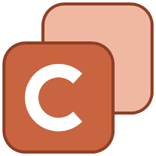
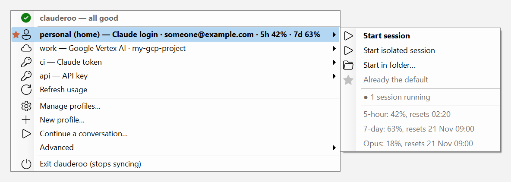
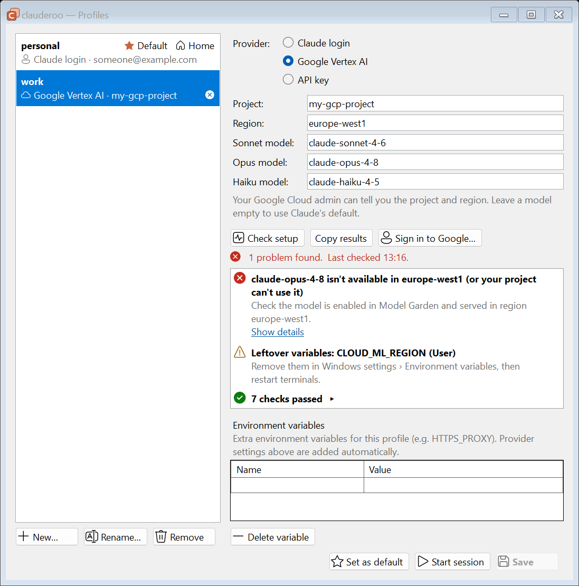

<p align="center">
  
</p>

<h1 align="center">clauderoo</h1>

<p align="center">
  <strong>Run Claude Code under several accounts on Windows, side by side.</strong><br>
  You get a CLI and a tray app, one profile per account, and shared plugins, skills, settings and MCP servers.
</p>

<p align="center">
  
  
  <a href="LICENSE"></a>
  
  
</p>

<p align="center">
  <a href="#installation">Installation</a> ·
  <a href="#quick-start">Quick start</a> ·
  <a href="#commands">Commands</a> ·
  <a href="#providers">Providers</a> ·
  <a href="#how-it-works">How it works</a> ·
  <a href="#development">Development</a>
</p>

---

```powershell
cr start personal      # your own Claude account, in this terminal
cr start work          # your company's Vertex AI project, in another terminal, at the same time
```

## Why

Claude Code keeps its login, history and settings in one folder (`~/.claude`). If you use one account for work and another at home, you have to log out and back in each time you switch. You also can't have both open at once.

clauderoo gives each account its own **profile**, a separate config folder with its own login and history. Everything you've set up once is shared: plugins, skills, hooks, agents, commands, `settings.json`, `CLAUDE.md` and MCP servers. Your existing `~/.claude` becomes the **home** profile and clauderoo never writes to it.

## Features

- **Side-by-side sessions.** Run `work` and `personal` in different terminals at the same time.
- **Four ways to sign in.** Each profile can use its own Claude login, a **Claude token** from `claude setup-token`, **Google Vertex AI** or an Anthropic **API key**. Keys and tokens are stored encrypted with Windows DPAPI.
- **Folder mapping.** Map a folder to a profile and `cr start` there picks it without a name.
- **Isolated sessions.** `cr start work --isolated` runs a profile with nothing shared: no plugins, skills, hooks or MCP servers.
- **Shared setup.** Shared folders are linked with junctions, and shared files are copied one way from home, with a backup made before anything is overwritten.
- **Default profile.** Pick which profile a plain `claude` uses in new terminals.
- **Vertex setup check.** A read-only checklist covers gcloud, sign-in, IAM permission, leftover environment variables and a live test of each model. All checks run in parallel, with live progress.
- **Tray app.** Start sessions, switch the default profile and see problems at a glance. The tray icon shows a badge when something needs attention.
- **Profile manager window.** Choose a provider, edit environment variables, rename, remove and restore profiles, and run the setup check.
- **Safe by design.** Removed profiles are moved, never deleted. clauderoo never reads `.credentials.json` or prints tokens.

## Screenshots

<p align="center">
  <br>
  <em>Tray menu: one entry per profile, with its provider, signed-in account, default marker and running sessions.</em>
</p>

<p align="center">
  <br>
  <em>Profile manager: provider settings, setup check results with fix hints, and per-profile environment variables.</em>
</p>

## Requirements

| | |
| --- | --- |
| OS | Windows 10 or 11 (x64) |
| Runtime | [.NET 10 Desktop Runtime](https://dotnet.microsoft.com/download/dotnet/10.0). Building from source needs the .NET 10 SDK |
| Claude Code | `claude` on your `PATH` |
| Optional | [Windows Terminal](https://aka.ms/terminal) for `--tab`; [Google Cloud CLI](https://cloud.google.com/sdk/docs/install) for Vertex profiles |

## Installation

### Install from Releases

Download `clauderoo-<version>-win-x64.zip` from the GitHub Releases page, unzip it and run the installer from the unzipped folder:

```powershell
.\clauderoo.exe install
```

The release also has a `.sha256` file if you want to check the download yourself. The zip holds the same three programs described below, so the notes after the source instructions apply to both ways.

### Build from source

Publish both projects as single-file builds into one folder, then run the installer from that folder:

```powershell
git clone <repo-url> clauderoo
cd clauderoo
dotnet publish src\Clauderoo.Cli  -c Release -r win-x64 -p:PublishSingleFile=true --self-contained false -o publish
dotnet publish src\Clauderoo.Tray -c Release -r win-x64 -p:PublishSingleFile=true --self-contained false -o publish
publish\clauderoo.exe install
```

`install` copies three programs to `%LOCALAPPDATA%\clauderoo` and adds that folder to your user `PATH`:

| File | What it is |
| --- | --- |
| `clauderoo.exe` | The CLI |
| `cr.exe` | Short alias: `cr start work` is the same as `clauderoo start work` |
| `clauderoow.exe` | The tray app and profile manager, without a console window |

Open a new terminal afterwards so the `PATH` change takes effect.

**Upgrading:** from a release install, run `cr upgrade`. It downloads the latest release, checks its SHA256 and runs its installer. The tray app also checks once a day and offers "Update to vX" in its menu (turn this off under Advanced). From a source build, pull, publish again and rerun `publish\clauderoo.exe install`. Running copies are moved aside and replaced, and if copying fails the old version is put back.

**Uninstalling:** quit the tray app, then run `cr uninstall`. It turns autostart off, removes the install folder from your `PATH` and removes the folder a few seconds later. Your profiles, logins and settings in `%USERPROFILE%\.clauderoo` are kept.

## Quick start

```powershell
cr init                      # adopt your existing ~/.claude as the "home" profile
cr add work                  # create a second profile
cr start work                # start Claude for it in this terminal and log in once
cr default work              # optional: make plain `claude` use it in new terminals
cr tray                      # optional: start the tray app
cr autostart on              # optional: start the tray app when you log in
```

If you'd rather use the window, run `cr manage`. To open a session in a new Windows Terminal tab instead of the current one, add `--tab`.

## Commands

All commands work with either `clauderoo` or `cr`.

`list`, `status`, `maps`, `which` and `check` take `--json` for scripts; other commands refuse it. The output starts with `"schemaVersion": 1`. `check --json` has the same shape for every provider: `{ok, verified, message, items}`, where `items` is the Vertex checklist and is empty for other providers. An error goes to stderr as `{"schemaVersion":1,"error":"…"}`. Exit codes: 0 = success, 1 = error (including a failed check), 2 = unexpected error.

### Profiles

| Command | What it does |
| --- | --- |
| `init [--name <n>] [--home <path>]` | Set up clauderoo around your existing `~/.claude` |
| `add <name>` | Create a profile (names may use `a-z`, `0-9` and `-`) |
| `list [--json]` | List profiles and the account each one is logged in with |
| `rename <old> <new> [--force]` | Rename a profile. Its folder, config, secrets and env var move together. Close the profile's Claude sessions first and restart them with `cr start <new>`. `--force` skips the shared-plugin-records and running-session checks. Only sessions started by clauderoo are detected |
| `remove <name> [--force]` | Remove a profile. Its folder is moved, not deleted. Refuses while sessions of it started by clauderoo are running; `--force` overrides |
| `restore <name>` | Bring back the most recently removed profile with that name. Refuses if the name is taken. Its saved provider comes back too; an API key or Claude token was deleted on removal and must be entered again |
| `default <name>` / `default --clear` | Choose which profile plain `claude` uses in new terminals |

### Sessions

| Command | What it does |
| --- | --- |
| `start [name] [dir] [-- args]` | Run Claude for a profile in this terminal (`run` does the same). Without a name, the folder's mapping picks the profile, or else the default |
| `start [name] [dir] --tab [-- args]` | Open it in a new Windows Terminal tab instead. Prompts there can't contain `" % ! ;` |
| `start [name] [dir] --isolated` | Run with a separate config folder: no shared plugins, skills, hooks or MCP servers. A Claude login profile needs its own `/login` there once; other providers work right away |
| `which [--json]` | Show which profile this terminal is using, and why |

### Folders

| Command | What it does |
| --- | --- |
| `map <name> [dir]` | Use the profile for `dir` (default: the current folder) and every folder inside it |
| `unmap [dir]` | Remove a folder mapping |
| `maps [--json]` | List folder mappings |

The longest mapped folder wins. Mappings follow a profile when it's renamed and are dropped when it's removed. You can also edit them under **Folders** in the manager window.

### Providers and environment

| Command | What it does |
| --- | --- |
| `provider <name> login\|vertex\|apikey\|token` | Choose how a profile signs in. `vertex` takes `--project`, `--region` and optionally `--sonnet`, `--opus` and `--haiku`. `apikey` prompts for the key. `token` prompts for a token from `claude setup-token` |
| `env <name> [set A=1 B=2 \| unset A]` | Show, set or unset a profile's environment variables |
| `check <name> [--json]` | Check that the profile's sign-in works. For a Vertex profile it runs the full setup checklist. Exits with code 1 if anything fails |
| `apikey <name>` | Print the profile's API key. This is what Claude's `apiKeyHelper` runs |

### Sharing

| Command | What it does |
| --- | --- |
| `own <name> <item>` | Give a profile its own copy of a shared item |
| `share <name> <item>` | Go back to sharing that item from the home profile |

### App

| Command | What it does |
| --- | --- |
| `manage` | Open the profile manager window |
| `status [--json]` | Show the default profile and any problems |
| `tray` | Start the tray app |
| `autostart on\|off` | Start the tray app when you log in, or stop doing so |
| `install` | Copy clauderoo to `%LOCALAPPDATA%\clauderoo` and add it to `PATH` |
| `version` | Print the installed version (`--version` works too) |
| `upgrade [--check]` | Install the latest GitHub release after verifying its SHA256. `--check` only says whether a newer one exists. Builds not made from a release can't upgrade |
| `uninstall [--yes]` | Turn off autostart, remove clauderoo from `PATH` and delete the install folder. Asks whether to clear the default profile; `--yes` clears it without asking. Profile data is kept. Quit the tray app first |

## Providers

Every profile except home can sign in its own way:

| Provider | How it signs in |
| --- | --- |
| **Claude login** (default) | The profile's own `/login`, stored in its own folder |
| **Google Vertex AI** | Your Google Cloud sign-in (Application Default Credentials) against a GCP project and region |
| **API key** | An Anthropic API key, stored encrypted for your Windows user with DPAPI and handed to Claude through `apiKeyHelper` |
| **Claude token** | A long-lived token from `claude setup-token`, stored encrypted with DPAPI and passed to Claude as `CLAUDE_CODE_OAUTH_TOKEN` when clauderoo starts the session. It never goes into `settings.json`, so a plain `claude` isn't signed in with it: start token profiles with `cr start` or from the tray |

The home profile always uses its own Claude login.

You can pick the provider and edit environment variables in the manager window (`cr manage`, or **Manage profiles…** in the tray). From the command line:

```powershell
cr provider work vertex --project my-gcp-project --region us-east5 [--sonnet <model>] [--opus <model>] [--haiku <model>]
cr provider work apikey          # reads the key from stdin or prompts for it without showing it
cr provider work token           # the same, for a token from `claude setup-token`
cr provider work login
cr env work set HTTPS_PROXY=http://proxy:8080
cr env work unset HTTPS_PROXY
cr check work
```

If you accept a model update from inside Claude (for example, moving Opus to a newer version), clauderoo saves the new model to the profile. It isn't reverted on the next sync.

### Setting up Vertex AI

1. Install the Google Cloud CLI: `winget install Google.CloudSDK`.
2. Sign in twice. The first sign-in is for gcloud, the second is the one Claude uses:
   ```powershell
   gcloud auth login
   gcloud auth application-default login
   ```
3. Ask your Google Cloud admin for the **project ID** and **region**, and check that the Claude models are enabled in Model Garden.
4. Create the profile and run the check:
   ```powershell
   cr add work
   cr provider work vertex --project <project-id> --region <region>
   cr check work
   ```

### Check setup

`cr check <vertex-profile>`, or the **Check setup** button in the manager, runs a read-only checklist and changes nothing:

1. gcloud is installed.
2. Google sign-in works for Claude. clauderoo gets an access token to prove it but never shows the token.
3. `GOOGLE_APPLICATION_CREDENTIALS` is not set. If it were, it would override your sign-in.
4. Your account has the `aiplatform.endpoints.predict` permission on the project.
5. There are no leftover provider variables (`ANTHROPIC_*`, `CLAUDE_CODE_*`, `CLOUD_ML_*`, `VERTEX_REGION_*`) in your user or machine environment.
6. Claude Code is installed.
7. Each configured model answers a tiny test prompt. This sends one short request per model.

The checks run in parallel and the list updates as each one finishes. Each line is marked ✓ ok, ⚠ warning, ✗ failed or – skipped, with a hint on how to fix it. The exit code is 1 only if something failed.

<p align="center">
  
</p>

### Profiles that own their settings.json

If a profile owns its `settings.json`, set the provider first. Then run `cr share <profile> settings.json` to move the profile onto the shared copy plus the provider overlay.

In an owned `settings.json`, the provider's settings replace any Vertex or API-key keys you wrote by hand, such as `CLAUDE_CODE_USE_VERTEX`, `ANTHROPIC_API_KEY` and `apiKeyHelper`. The first time that happens, clauderoo saves a `settings.json.bak-<timestamp>` copy.

## How it works

```
%USERPROFILE%\.claude                      ← home profile (read-only to clauderoo)
%USERPROFILE%\.clauderoo\
├── config.json                            ← profiles, providers, env vars, default
└── profiles\
    ├── work\                              ← CLAUDE_CONFIG_DIR for "work"
    │   ├── plugins  ──junction──► ~/.claude/plugins
    │   ├── skills   ──junction──► ~/.claude/skills
    │   ├── settings.json   (copied from home + provider overlay)
    │   └── .claude.json    (own login; mcpServers merged from home)
    └── _removed\                          ← removed profiles end up here
```

Each profile is a `CLAUDE_CONFIG_DIR`. Starting a session sets that variable and the profile's environment variables, then runs `claude`. The default profile is set in your user environment, so new terminals pick it up.

### Sharing model

The home profile is the source of truth. Other profiles follow it in one direction only, from home to the profile:

- **Folders** (`plugins`, `skills`, `hooks`, `agents`, `commands`, `output-styles`) are junctions that point at the home folders.
- **Files** (`settings.json`, `CLAUDE.md`, `keybindings.json`) are copied.
- **MCP servers** (`mcpServers` in `~/.claude.json`) are merged into the profile's `.claude.json`.

If you edit a copied file inside a profile, the next sync replaces it with home's version and keeps a `.bak-<timestamp>` copy next to it. To keep a profile's own version, run `cr own <profile> <item>`, for example with `settings.json`, `skills` or `mcpServers`. `cr share <profile> <item>` goes back to following home.

### Safety guarantees

- clauderoo never writes inside `~/.claude` or `~/.claude.json`.
- It never opens, copies or logs `.credentials.json`.
- Tokens and API keys are never printed or logged, and API keys are stored only in encrypted form.
- Removed profiles are moved, never deleted, and junctions are unlinked before a move.

## Troubleshooting

<details>
<summary><strong>Plugins installed from a non-home profile</strong></summary>

If you install or update a plugin from a non-home profile, that profile's folder path is recorded in the shared plugin records (`plugins\installed_plugins.json`, `plugins\known_marketplaces.json`). It's best to manage plugins from the home profile.

`cr remove` refuses to remove a profile whose folder is referenced there. Reinstall those plugins from home, or use `cr remove <name> --force`.
</details>

<details>
<summary><strong>Cleaning up removed profiles</strong></summary>

Removed profiles are moved to `%USERPROFILE%\.clauderoo\profiles\_removed\<name>-<timestamp>`, never deleted, and their shared-folder junctions are unlinked first.

If you clean up `_removed` yourself, use Explorer or `rd /s`. **Don't** use PowerShell 5.1 `Remove-Item -Recurse` on these folders: it can follow junctions into the shared folders.
</details>

<details>
<summary><strong><code>cr</code> is not recognized after installing</strong></summary>

Open a new terminal. Terminals that were already open keep the old `PATH`. If it still isn't found, check that `%LOCALAPPDATA%\clauderoo` is in your user `PATH`.
</details>

<details>
<summary><strong>Vertex check says a model isn't available</strong></summary>

The model must be enabled in Model Garden for your project **and** served in the profile's region. Ask your admin which models and regions are enabled, or leave the model field empty to use Claude's default.
</details>

## Development

```powershell
dotnet build clauderoo.slnx
dotnet test  clauderoo.slnx
```

### Project layout

| Path | Contents |
| --- | --- |
| `src/Clauderoo.Core` | Profiles, config, sync, providers, sessions, setup check and installer. No UI |
| `src/Clauderoo.Cli` | Command-line entry point (`clauderoo.exe` / `cr.exe`) |
| `src/Clauderoo.Tray` | WinForms tray app and profile manager (`clauderoow.exe`) |
| `tests/Clauderoo.Core.Tests` | xUnit tests for Core and the Tray views |
| `tools/IconGen` | Generates the multi-size `.ico` files in `src/Clauderoo.Tray/Icons` |
| `docs/superpowers` | Design specs and implementation plans for each feature |

### Regenerating icons

```powershell
dotnet run --project tools\IconGen
```

This writes the app and status icons, including the high-contrast versions, to `src\Clauderoo.Tray\Icons`.

### Conventions

- Tests must never touch the real `~/.claude`, `%USERPROFILE%\.clauderoo` or user environment. Use the temp-folder fixtures in the test project.
- Never delete a junction recursively. Unlink it first.
- Write user-facing text in plain language and keep raw tool output in the **Show details** view.

## Contributing

Issues and pull requests are welcome. Before you open a PR:

1. Run `dotnet test` and make sure everything passes.
2. Add tests for any behaviour change.
3. Update this README if you add or change a command.

## License

[MIT](LICENSE) © 2026 Ivan Ficko
