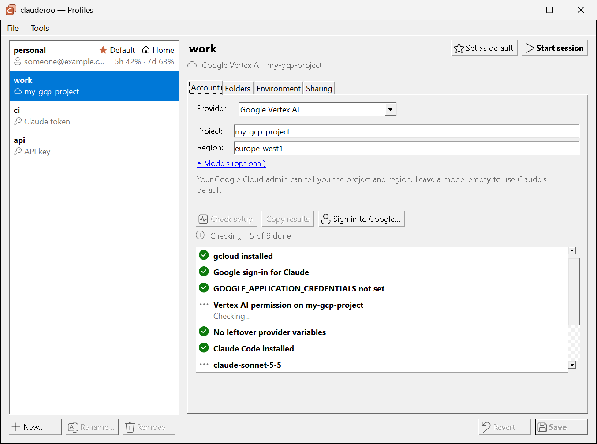

<p align="center">
  
</p>

<h1 align="center">clauderoo</h1>

<p align="center">
  <strong>Run Claude Code under several accounts on Windows, side by side.</strong><br>
  You get a CLI and a tray app, one profile per account, and shared plugins, skills, settings and MCP servers.
</p>

<p align="center">
  
  
  <a href="LICENSE"></a>
  
  
</p>

<p align="center">
  <a href="#installation">Installation</a> ·
  <a href="#quick-start">Quick start</a> ·
  <a href="#commands">Commands</a> ·
  <a href="#providers">Providers</a> ·
  <a href="#how-it-works">How it works</a> ·
  <a href="#development">Development</a>
</p>

---

```powershell
cr start personal      # your own Claude account, in this terminal
cr start work          # your company's Vertex AI project, in another terminal, at the same time
```

## Why

Claude Code keeps its login, history and settings in one folder (`~/.claude`). If you use one account for work and another at home, you have to log out and back in each time you switch. You also can't have both open at once.

clauderoo gives each account its own **profile**, a separate config folder with its own login and history. Everything you've set up once is shared: plugins, skills, hooks, agents, commands, `settings.json`, `CLAUDE.md` and MCP servers. Your existing `~/.claude` becomes the **home** profile and clauderoo never writes to it.

## Features

- **Side-by-side sessions.** Run `work` and `personal` in different terminals at the same time.
- **Four ways to sign in.** Each profile can use its own Claude login, a **Claude token** from `claude setup-token`, **Google Vertex AI** or an Anthropic **API key**. Keys and tokens are stored encrypted with Windows DPAPI.
- **Folder mapping.** Map a folder to a profile and `cr start` there picks it without a name.
- **Isolated sessions.** `cr start work --isolated` runs a profile with nothing shared: no plugins, skills, hooks or MCP servers.
- **Shared setup.** Shared folders are linked with junctions, and shared files are copied one way from home, with a backup made before anything is overwritten.
- **Default profile.** Pick which profile a plain `claude` uses in new terminals.
- **Vertex setup check.** A read-only checklist covers gcloud, sign-in, IAM permission, leftover environment variables and a live test of each model. All checks run in parallel, with live progress.
- **Tray app.** Start sessions, switch the default profile and see problems at a glance. The tray icon shows a badge when something needs attention.
- **Profile manager window.** Choose a provider, edit environment variables, rename, remove and restore profiles, export and import them, and run the setup check.
- **Usage limits.** See each Claude-login profile's 5-hour and 7-day usage (and per-model limits) with `cr usage`, in the tray menu and in the profile manager.
- **Auto-switch.** When the default profile nears a usage limit, new terminals move to another profile that has room.
- **MCP server.** `cr mcp` lets a Claude session list your profiles, check their usage, change the default and hand a one-shot prompt to another profile.
- **Safe by design.** Removed profiles are moved, never deleted. To fetch usage it reads only the access token, its expiry and the plan (subscription type and rate-limit tier), in memory only; the token is never written, copied, logged or shown.

## Screenshots

<p align="center">
  <br>
  <em>Tray menu: one entry per profile, with its provider, signed-in account, default marker and running sessions.</em>
</p>

<p align="center">
  <br>
  <em>Profile manager: provider settings, setup check results with fix hints, and per-profile environment variables.</em>
</p>

## Requirements

| | |
| --- | --- |
| OS | Windows 10 or 11 (x64) |
| Runtime | [.NET 10 Desktop Runtime](https://dotnet.microsoft.com/download/dotnet/10.0). Building from source needs the .NET 10 SDK |
| Claude Code | `claude` on your `PATH` |
| Optional | [Windows Terminal](https://aka.ms/terminal) for `--tab`; [Google Cloud CLI](https://cloud.google.com/sdk/docs/install) for Vertex profiles |

## Installation

### Install from Releases

Download `clauderoo-<version>-win-x64.zip` from the GitHub Releases page, unzip it and run the installer from the unzipped folder:

```powershell
.\clauderoo.exe install
```

The release also has a `.sha256` file if you want to check the download yourself. The zip holds the same three programs described below, so the notes after the source instructions apply to both ways.

### Build from source

Publish both projects as single-file builds into one folder, then run the installer from that folder:

```powershell
git clone <repo-url> clauderoo
cd clauderoo
dotnet publish src\Clauderoo.Cli  -c Release -r win-x64 -p:PublishSingleFile=true --self-contained false -o publish
dotnet publish src\Clauderoo.Tray -c Release -r win-x64 -p:PublishSingleFile=true --self-contained false -o publish
publish\clauderoo.exe install
```

`install` copies three programs to `%LOCALAPPDATA%\clauderoo` and adds that folder to your user `PATH`:

| File | What it is |
| --- | --- |
| `clauderoo.exe` | The CLI |
| `cr.exe` | Short alias: `cr start work` is the same as `clauderoo start work` |
| `clauderoow.exe` | The tray app and profile manager, without a console window |

Open a new terminal afterwards so the `PATH` change takes effect.

**Upgrading:** from a release install, run `cr upgrade`. It downloads the latest release, checks its SHA256 and runs its installer. The tray app also checks once a day and offers "Update to vX" in its menu (turn this off under Advanced). From a source build, pull, publish again and rerun `publish\clauderoo.exe install`. Running copies are moved aside and replaced, and if copying fails the old version is put back.

**Uninstalling:** quit the tray app, then run `cr uninstall`. It turns autostart off, removes the install folder from your `PATH` and removes the folder a few seconds later. Your profiles, logins and settings in `%USERPROFILE%\.clauderoo` are kept.

## Quick start

```powershell
cr init                      # adopt your existing ~/.claude as the "home" profile
cr add work                  # create a second profile
cr start work                # start Claude for it in this terminal and log in once
cr default work              # optional: make plain `claude` use it in new terminals
cr tray                      # optional: start the tray app
cr autostart on              # optional: start the tray app when you log in
```

If you'd rather use the window, run `cr manage`. To open a session in a new Windows Terminal tab instead of the current one, add `--tab`.

## Commands

All commands work with either `clauderoo` or `cr`.

`list`, `status`, `maps`, `which`, `check`, `usage` and `sessions` take `--json` for scripts; other commands refuse it. The output starts with `"schemaVersion": 1`. `check --json` has the same shape for every provider: `{ok, verified, message, items}`, where `items` is the Vertex checklist and is empty for other providers. An error goes to stderr as `{"schemaVersion":1,"error":"…"}`. Exit codes: 0 = success, 1 = error (including a failed check), 2 = unexpected error.

### Profiles

| Command | What it does |
| --- | --- |
| `init [--name <n>] [--home <path>]` | Set up clauderoo around your existing `~/.claude` |
| `add <name>` | Create a profile (names may use `a-z`, `0-9` and `-`) |
| `list [--json]` | List profiles and the account each one is logged in with, plus the last known 5h/7d usage of Claude-login profiles |
| `usage [name] [--json]` | Show 5-hour and 7-day usage, reset times, plan and per-model limits for every profile, or just `name`. Fetches live and falls back to the last reading ("as of hh:mm") when offline or rate-limited. Vertex, API-key and Claude-token profiles show "Usage isn't tracked for …". `--json` prints `{profiles:[{name, status, plan, fetchedAt, windows:[{name, percent, resetsAt}], message}]}` |
| `rename <old> <new> [--force]` | Rename a profile. Its folder, config, secrets and env var move together. Close the profile's Claude sessions first and restart them with `cr start <new>`. `--force` skips the shared-plugin-records and running-session checks. Only sessions started by clauderoo are detected |
| `remove <name> [--force]` | Remove a profile. Its folder is moved, not deleted. Refuses while sessions of it started by clauderoo are running; `--force` overrides |
| `restore <name>` | Bring back the most recently removed profile with that name. Refuses if the name is taken. Its saved provider comes back too; an API key or Claude token was deleted on removal and must be entered again |
| `default <name>` / `default --clear` | Choose which profile plain `claude` uses in new terminals |
| `auto [on\|off] [--threshold N] [--order a,b,c]` | Turn [auto-switch](#auto-switch) on or off, set the threshold (6 to 100, default 90) and the profiles to switch to, in order. With no arguments, it shows the current settings |
| `auto --once [--json]` | Check usage now and switch the default if it has reached the threshold. Exit codes: 0 switched, 2 nothing to do, 3 no other profile has room, 1 error. For Task Scheduler when the tray isn't running |

### Sessions

| Command | What it does |
| --- | --- |
| `start [name] [dir] [-- args]` | Run Claude for a profile in this terminal (`run` does the same). Without a name, the folder's mapping picks the profile, or else the default |
| `start [name] [dir] --tab [-- args]` | Open it in a new Windows Terminal tab instead. Prompts there can't contain `" % ! ;` |
| `start [name] [dir] --isolated` | Run with a separate config folder: no shared plugins, skills, hooks or MCP servers. A Claude login profile needs its own `/login` there once; other providers work right away |
| `which [--json]` | Show which profile this terminal is using, and why |
| `sessions [profile] [--json]` | List conversations across profiles (home's read-only, isolated folders included), newest first: id, profile, when, folder and your first prompt |
| `resume <id> --as <profile> [--isolated] [--tab] [-- args]` | Continue a conversation under another profile. The start of the id is enough. It's copied into that profile (a newer or bigger copy there is kept; an older one is saved as `.bak-<time>`), then Claude starts in the conversation's own folder with `--resume`. Anything after `--` is passed on to Claude. It can't copy into the home profile, because clauderoo never writes inside `~/.claude`; `--as <home> --isolated` works, since that folder is clauderoo's |

The tray does the same from **Continue a conversation…**. The window lists conversations across your profiles (when, profile, folder and your first prompt; nothing else of a conversation is shown), with a search box and a profile filter. Pick one, choose **Continue as** and press **Continue**: the conversation is copied into that profile and Claude opens in a new tab, in the conversation's own folder, resumed. The home profile appears only as "(isolated)" there, because clauderoo never writes inside `~/.claude`. If the conversation's folder no longer exists, the window says so instead of starting.

### Folders

| Command | What it does |
| --- | --- |
| `map <name> [dir]` | Use the profile for `dir` (default: the current folder) and every folder inside it |
| `unmap [dir]` | Remove a folder mapping |
| `maps [--json]` | List folder mappings |

The longest mapped folder wins. Mappings follow a profile when it's renamed and are dropped when it's removed. You can also edit them under **Folders** in the manager window.

### Providers and environment

| Command | What it does |
| --- | --- |
| `provider <name> login\|vertex\|apikey\|token` | Choose how a profile signs in. `vertex` takes `--project`, `--region` and optionally `--sonnet`, `--opus` and `--haiku`. `apikey` prompts for the key. `token` prompts for a token from `claude setup-token` |
| `env <name> [set A=1 B=2 \| unset A]` | Show, set or unset a profile's environment variables |
| `check <name> [--json]` | Check that the profile's sign-in works. For a Vertex profile it runs the full setup checklist. Exits with code 1 if anything fails |
| `apikey <name>` | Print the profile's API key. This is what Claude's `apiKeyHelper` runs |

### Export and import

| Command | What it does |
| --- | --- |
| `export <file> [names…] [--no-env] [--force]` | Save profile settings (provider, Vertex project and models, environment, owned items, start folder) and folder mappings to a file. Without names, every profile except home is exported. An existing file is only replaced with `--force` |
| `import <file> [--force]` | Create the profiles in an export and add their folder mappings. Existing profiles are skipped and listed; `--force` updates them instead |

Import only files from people you trust: environment variables and folder mappings take effect in new sessions.

Exports never contain API keys, tokens, logins, usage data or the home flag. Environment values are written as plain text, so check the file before sharing it, or leave them out with `--no-env`. API-key and token profiles are imported with the Claude login; the import lists them, and you set the secret with `cr provider <name> apikey` or `cr provider <name> token`.

Folder mappings in the file are added for new and existing profiles alike, even without `--force`; a folder already mapped to another profile is skipped. With `--force`, an import also:

- updates the settings of profiles that already exist (provider, Vertex project and models, environment, start folder);
- re-points folders that are already mapped to another profile;
- keeps the provider of a profile that holds an API key or token, so the secret is never deleted.

An import only ever adds owned items. It never gives a profile's own copies back to home, with or without `--force`. A start folder that doesn't exist on this machine is left out and reported. The summary lists what was created, updated and mapped, the names (never the values) of the environment variables that arrived, and anything skipped.

The manager window has the same two actions under the profile list. **Export…** exports every profile except home: it asks whether to include environment variables (with a plain-text warning), then where to save `clauderoo-profiles.json`. To share a single profile, use `cr export <file> <name>`. **Import…** opens a file, asks "Update profiles that already exist? Choose No to skip them.", and then shows the same summary.

**Onboarding a colleague on Vertex.**

1. Export the Vertex profile with `cr export vertex.json work`. (**Export…** in the window exports every profile except home.)
2. Your colleague imports it (`cr import vertex.json`, or **Import…** in the window).
3. They sign in to gcloud (**Sign in to Google…** in the window, or `gcloud auth application-default login`).
4. They run **Check setup** (`cr check <name>`) to confirm everything works.

### Sharing

| Command | What it does |
| --- | --- |
| `own <name> <item>` | Give a profile its own copy of a shared item |
| `share <name> <item>` | Go back to sharing that item from the home profile |

### App

| Command | What it does |
| --- | --- |
| `manage` | Open the profile manager window |
| `status [--json]` | Show the default profile and any problems |
| `tray` | Start the tray app |
| `autostart on\|off` | Start the tray app when you log in, or stop doing so |
| `install` | Copy clauderoo to `%LOCALAPPDATA%\clauderoo` and add it to `PATH` |
| `version` | Print the installed version (`--version` works too) |
| `upgrade [--check]` | Install the latest GitHub release after verifying its SHA256. `--check` only says whether a newer one exists. Builds not made from a release can't upgrade |
| `uninstall [--yes]` | Turn off autostart, remove clauderoo from `PATH` and delete the install folder. Asks whether to clear the default profile; `--yes` clears it without asking. Profile data is kept. Quit the tray app first |
| `mcp` | Run clauderoo's MCP server over stdio. Claude Code starts it; you don't run it yourself. See [MCP server](#mcp-server) |
| `mcp install` | Print the `claude mcp add` command that registers the server, and copy it to the clipboard. It never runs it |

## Providers

Every profile except home can sign in its own way:

| Provider | How it signs in |
| --- | --- |
| **Claude login** (default) | The profile's own `/login`, stored in its own folder |
| **Google Vertex AI** | Your Google Cloud sign-in (Application Default Credentials) against a GCP project and region |
| **API key** | An Anthropic API key, stored encrypted for your Windows user with DPAPI and handed to Claude through `apiKeyHelper` |
| **Claude token** | A long-lived token from `claude setup-token`, stored encrypted with DPAPI and passed to Claude as `CLAUDE_CODE_OAUTH_TOKEN` when clauderoo starts the session. It never goes into `settings.json`, so a plain `claude` isn't signed in with it: start token profiles with `cr start` or from the tray |

The home profile always uses its own Claude login.

You can pick the provider and edit environment variables in the manager window (`cr manage`, or **Manage profiles…** in the tray). From the command line:

```powershell
cr provider work vertex --project my-gcp-project --region us-east5 [--sonnet <model>] [--opus <model>] [--haiku <model>]
cr provider work apikey          # reads the key from stdin or prompts for it without showing it
cr provider work token           # the same, for a token from `claude setup-token`
cr provider work login
cr env work set HTTPS_PROXY=http://proxy:8080
cr env work unset HTTPS_PROXY
cr check work
```

If you accept a model update from inside Claude (for example, moving Opus to a newer version), clauderoo saves the new model to the profile. It isn't reverted on the next sync.

### Setting up Vertex AI

1. Install the Google Cloud CLI: `winget install Google.CloudSDK`.
2. Sign in twice. The first sign-in is for gcloud, the second is the one Claude uses:
   ```powershell
   gcloud auth login
   gcloud auth application-default login
   ```
3. Ask your Google Cloud admin for the **project ID** and **region**, and check that the Claude models are enabled in Model Garden.
4. Create the profile and run the check:
   ```powershell
   cr add work
   cr provider work vertex --project <project-id> --region <region>
   cr check work
   ```

### Check setup

`cr check <vertex-profile>`, or the **Check setup** button in the manager, runs a read-only checklist and changes nothing:

1. gcloud is installed.
2. Google sign-in works for Claude. clauderoo gets an access token to prove it but never shows the token.
3. `GOOGLE_APPLICATION_CREDENTIALS` is not set. If it were, it would override your sign-in.
4. Your account has the `aiplatform.endpoints.predict` permission on the project.
5. There are no leftover provider variables (`ANTHROPIC_*`, `CLAUDE_CODE_*`, `CLOUD_ML_*`, `VERTEX_REGION_*`) in your user or machine environment.
6. Claude Code is installed.
7. Each configured model answers a tiny test prompt. This sends one short request per model.

The checks run in parallel and the list updates as each one finishes. Each line is marked ✓ ok, ⚠ warning, ✗ failed or – skipped, with a hint on how to fix it. The exit code is 1 only if something failed.

<p align="center">
  
</p>

### Usage limits

For Claude-login profiles (home included), clauderoo shows how much of the subscription's 5-hour and 7-day windows is used, plus any per-model limits:

- **CLI:** `cr usage [name]` prints a table; `cr usage --json` prints the same as JSON. `cr list` adds a `5h/7d` column from the last reading.
- **Tray:** each profile line ends with `· 5h 42% · 7d 63%`, and its submenu lists each window with its reset time, such as "5-hour: 42%, resets 15:40". **Refresh usage** checks again right away.
- **Profile manager:** a **Usage** group shows a bar per window (green below 70%, amber from 70%, red from 90%), the reset time, the plan, when it was read ("as of") and a **Refresh** button.

Vertex, API-key and Claude-token profiles have no subscription limits to show. The CLI, the tray submenu and the profile manager say so, for example "Usage isn't tracked for Claude token.", and `--json` gives them the status `notTracked`. clauderoo never reads their sign-in file and never calls the usage service for them.

The tray checks every 5 minutes, or every 2 minutes for a profile with a session running. When the service asks it to slow down it waits at least 10 minutes, and after 3 failures in a row it waits longer each time, up to 30 minutes. Readings are kept in `%USERPROFILE%\.clauderoo\usage.json` (times, plan and percentages only, never a token).

clauderoo never refreshes a sign-in. When a profile's sign-in has expired, usage says so; start a session of that profile and Claude refreshes it.

The usage endpoint isn't documented by Anthropic. If it changes, usage shows as unavailable and everything else keeps working.

### MCP server

`cr mcp` is an MCP server (stdio, JSON-RPC 2.0) that gives Claude Code four clauderoo tools:

| Tool | What it does |
| --- | --- |
| `list_profiles` | Each profile's name, provider, account or Vertex project, whether it's the default, its running sessions and its last saved usage. Uses no quota |
| `usage {profile?}` | 5-hour and 7-day usage for one profile or all of them. Uses no quota. A reading under 2 minutes old is reused, each profile is checked at most once every 2 minutes, and a rate limit is waited out for at least 10 minutes |
| `set_default {profile}` | Make a profile the default for new terminals. It counts as choosing the default yourself, so auto-switch leaves it alone |
| `delegate {profile, prompt, cwd?}` | Run a one-shot `claude -p` under another profile and return its output |

**Registering it.** clauderoo never writes `~/.claude.json`. Run `cr mcp install`, or click **Use from Claude…** in the profile manager, and you get this command to run once in a terminal:

```powershell
claude mcp add --scope user clauderoo -- "%LOCALAPPDATA%\clauderoo\cr.exe" mcp
```

Run it from a terminal using your home profile. Every profile then gets it through the shared MCP servers.

**What `delegate` will and won't do:**

- The prompt goes to `claude` on **stdin**. It is never on the command line, so it can't be read as a `claude` option. Prompts with a NUL character or over 100 KB are refused.
- The run uses the **target profile's own permissions** and allow-list. `-p` can't ask, so anything that would need your approval is denied. clauderoo never passes `--dangerously-skip-permissions` or any `--permission-mode`.
- It runs with `--strict-mcp-config` and an empty MCP config, so it can't load MCP servers, clauderoo's included.
- It refuses the profile the calling session runs under, when that session was started by clauderoo (`CLAUDEROO_PROFILE`).
- The run doesn't inherit the calling session's provider, model or account: variables such as `CLAUDE_CODE_USE_VERTEX`, `ANTHROPIC_API_KEY`, `ANTHROPIC_BASE_URL`, `ANTHROPIC_MODEL`, any variable a profile sets with `cr env`, and every `CLAUDECODE*` and `CLAUDE_CODE_*` variable are removed. Only the target profile's own settings apply.
- It refuses these working folders (`cwd`), matched by name and by real location (through junctions and links):
  - your user folder itself, and every folder above it, such as `C:\Users` and `C:\`;
  - `~/.clauderoo`, `~/.claude` (or the home profile's folder), `~/.ssh` and `%APPDATA%\gcloud`, anything inside them, and any folder that contains one of them;
  - network (UNC) folders, and folders whose real location can't be resolved.

  The default is the server's working folder.
- At most **2** delegated runs are in progress at once. A third gets "2 delegated runs are already in progress; try again when one finishes."
- It uses the **target account's quota**.
- It stops after **10 minutes** and kills the run's process tree. Runs also stop when the MCP client goes away.
- Output is cut to 100 KB per stream, and the target's sign-in and setup tokens are scrubbed from it.

### Auto-switch

Auto-switch changes the default profile when the default reaches a share of its 5-hour or 7-day limit (90% unless you change it). From then on, new terminals use the new default. Sessions that are already running keep their profile.

- **Turning it on:** tick **Advanced → Auto-switch default at 90%** in the tray, use the **Auto-switch…** button in the profile manager, or run `cr auto on`.
- **Threshold and order:** set them in the **Auto-switch…** dialog, or with `cr auto --threshold 85 --order work,personal`. The threshold can be 6 to 100.
- **Which profile it picks:** the first profile in the order whose last reading is under 15 minutes old and has both windows more than 5 points below the threshold. With no order set, every Claude-login profile is tried in list order. Vertex and API-key profiles have no limits to check, so they are used only when you list them in the order. Claude-token profiles are never auto-switch targets, because their usage isn't tracked, so `cr auto --order` refuses them.
- **No flip-flopping:** after a switch, nothing changes for 10 minutes. clauderoo never switches back on its own.
- **Your choice wins:** when you set the default yourself (tray, profile manager, `cr default` or the MCP `set_default` tool), auto-switch leaves that profile alone, even if it is over the threshold, until it is back under the threshold. The next time it crosses, auto-switch acts again.
- **What the tray tells you:** a balloon such as "personal is at 92% of its 5-hour limit. New terminals now use work." When no other profile has room, a balloon says so once each time the default crosses the threshold. When the profile it switched away from has room again, a balloon says "personal has room again". Click it to make that profile the default again.
- **In the tray menu:** a usage window at or above the threshold is shown in amber, or red from 90%. While auto-switch is off, only windows at 90% or more are coloured.

The tray decides each time it checks usage, every 2 to 5 minutes. When the tray isn't running, `cr auto --once` fetches usage, decides and switches once. Schedule it in Task Scheduler, for example every 10 minutes, and check its exit code:

| Exit code | Meaning |
| --- | --- |
| 0 | Switched the default |
| 2 | Nothing to do (or auto-switch is off, or the default was chosen by hand) |
| 3 | The default is at the threshold, but no other profile has room |
| 1 | Error |

Every clauderoo command, `cr auto --once` included, also exits with 2 on an unexpected error (a bug or an unforeseen failure), with the message on stderr. To tell that apart from "nothing to do", check that stderr is empty, or use `--json`: a real result is a JSON document on stdout with an `action` of `switched`, `none` or `noTarget`, and an error is `{"schemaVersion":1,"error":"…"}` on stderr.

`--json` prints `{"schemaVersion": 1, "action", "from", "to", "reason"}` instead of plain text. The switch state (last switch time, which profile it switched from, and a profile chosen by hand) is kept in `%USERPROFILE%\.clauderoo\autoswitch.json`.

### Profiles that own their settings.json

If a profile owns its `settings.json`, set the provider first. Then run `cr share <profile> settings.json` to move the profile onto the shared copy plus the provider overlay.

In an owned `settings.json`, the provider's settings replace any Vertex or API-key keys you wrote by hand, such as `CLAUDE_CODE_USE_VERTEX`, `ANTHROPIC_API_KEY` and `apiKeyHelper`. The first time that happens, clauderoo saves a `settings.json.bak-<timestamp>` copy.

## How it works

```
%USERPROFILE%\.claude                      ← home profile (read-only to clauderoo)
%USERPROFILE%\.clauderoo\
├── config.json                            ← profiles, providers, env vars, default
└── profiles\
    ├── work\                              ← CLAUDE_CONFIG_DIR for "work"
    │   ├── plugins  ──junction──► ~/.claude/plugins
    │   ├── skills   ──junction──► ~/.claude/skills
    │   ├── settings.json   (copied from home + provider overlay)
    │   └── .claude.json    (own login; mcpServers merged from home)
    └── _removed\                          ← removed profiles end up here
```

Each profile is a `CLAUDE_CONFIG_DIR`. Starting a session sets that variable and the profile's environment variables, then runs `claude`. The default profile is set in your user environment, so new terminals pick it up.

### Sharing model

The home profile is the source of truth. Other profiles follow it in one direction only, from home to the profile:

- **Folders** (`plugins`, `skills`, `hooks`, `agents`, `commands`, `output-styles`) are junctions that point at the home folders.
- **Files** (`settings.json`, `CLAUDE.md`, `keybindings.json`) are copied.
- **MCP servers** (`mcpServers` in `~/.claude.json`) are merged into the profile's `.claude.json`.

If you edit a copied file inside a profile, the next sync replaces it with home's version and keeps a `.bak-<timestamp>` copy next to it. To keep a profile's own version, run `cr own <profile> <item>`, for example with `settings.json`, `skills` or `mcpServers`. `cr share <profile> <item>` goes back to following home.

### Safety guarantees

- clauderoo never writes inside `~/.claude` or `~/.claude.json`.
- From each Claude-login profile's `.credentials.json`, clauderoo reads only the access token, its expiry and the plan (subscription type and rate-limit tier), in memory only, to fetch usage. It never writes, copies, logs or shows the token, and never refreshes it. It never reads the sign-in file of a Vertex, API-key or Claude-token profile.
- Tokens and API keys are never printed or logged, and API keys and Claude tokens are stored only in encrypted form (DPAPI).
- Removed profiles are moved, never deleted, and junctions are unlinked before a move.

## Troubleshooting

<details>
<summary><strong>Plugins installed from a non-home profile</strong></summary>

If you install or update a plugin from a non-home profile, that profile's folder path is recorded in the shared plugin records (`plugins\installed_plugins.json`, `plugins\known_marketplaces.json`). It's best to manage plugins from the home profile.

`cr remove` refuses to remove a profile whose folder is referenced there. Reinstall those plugins from home, or use `cr remove <name> --force`.
</details>

<details>
<summary><strong>Cleaning up removed profiles</strong></summary>

Removed profiles are moved to `%USERPROFILE%\.clauderoo\profiles\_removed\<name>-<timestamp>`, never deleted, and their shared-folder junctions are unlinked first.

If you clean up `_removed` yourself, use Explorer or `rd /s`. **Don't** use PowerShell 5.1 `Remove-Item -Recurse` on these folders: it can follow junctions into the shared folders.
</details>

<details>
<summary><strong><code>cr</code> is not recognized after installing</strong></summary>

Open a new terminal. Terminals that were already open keep the old `PATH`. If it still isn't found, check that `%LOCALAPPDATA%\clauderoo` is in your user `PATH`.
</details>

<details>
<summary><strong>Vertex check says a model isn't available</strong></summary>

The model must be enabled in Model Garden for your project **and** served in the profile's region. Ask your admin which models and regions are enabled, or leave the model field empty to use Claude's default.
</details>

## Development

```powershell
dotnet build clauderoo.slnx
dotnet test  clauderoo.slnx
```

### Project layout

| Path | Contents |
| --- | --- |
| `src/Clauderoo.Core` | Profiles, config, sync, providers, sessions, setup check and installer. No UI |
| `src/Clauderoo.Cli` | Command-line entry point (`clauderoo.exe` / `cr.exe`) |
| `src/Clauderoo.Tray` | WinForms tray app and profile manager (`clauderoow.exe`) |
| `tests/Clauderoo.Core.Tests` | xUnit tests for Core and the Tray views |
| `tools/IconGen` | Generates the multi-size `.ico` files in `src/Clauderoo.Tray/Icons` |
| `docs/superpowers` | Design specs and implementation plans for each feature |

### Regenerating icons

```powershell
dotnet run --project tools\IconGen
```

This writes the app and status icons, including the high-contrast versions, to `src\Clauderoo.Tray\Icons`.

### Conventions

- Tests must never touch the real `~/.claude`, `%USERPROFILE%\.clauderoo` or user environment. Use the temp-folder fixtures in the test project.
- Never delete a junction recursively. Unlink it first.
- Write user-facing text in plain language and keep raw tool output in the **Show details** view.

## Contributing

Issues and pull requests are welcome. Before you open a PR:

1. Run `dotnet test` and make sure everything passes.
2. Add tests for any behaviour change.
3. Update this README if you add or change a command.

## License

[MIT](LICENSE) © 2026 Ivan Ficko
